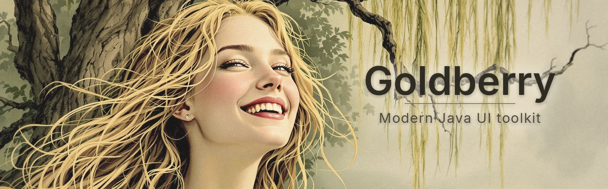
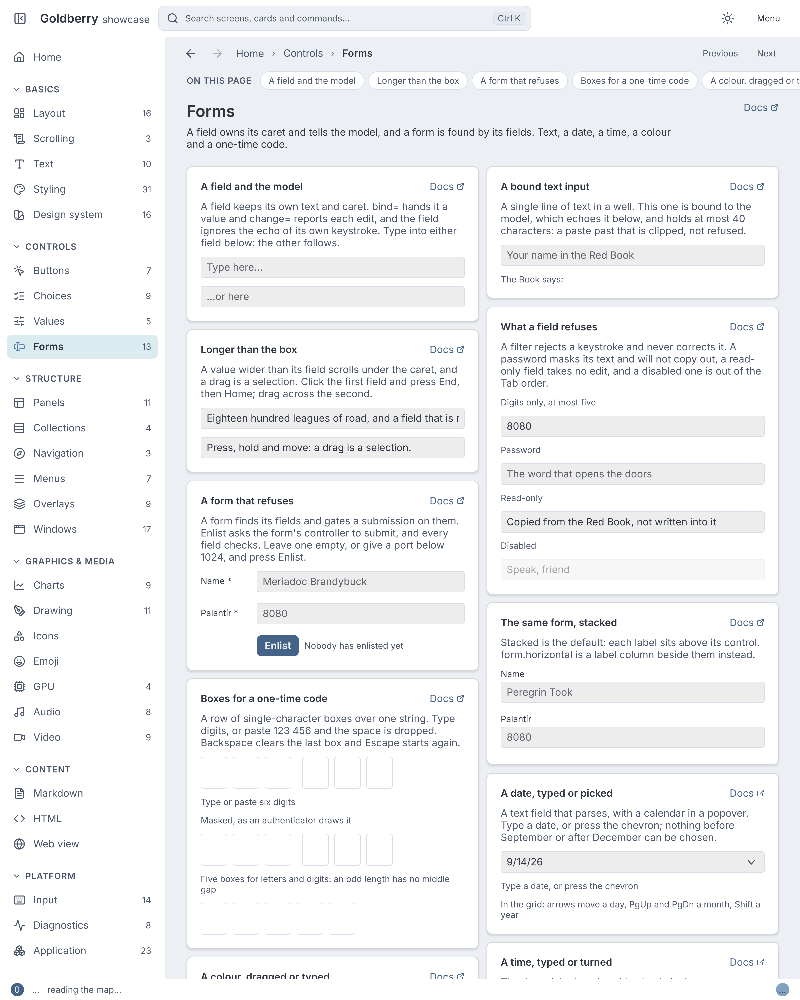

<p align="center">
  
</p>

<p align="center">
  <b>A fast and modern UI toolkit for Java.</b><br>
  Declarative widgets, real CSS, flexbox layout and GraalVM native images, on Linux, Windows and macOS.
</p>

<div align="center">

[](https://central.sonatype.com/artifact/dev.goldberry/goldberry)

[](https://goldberry.dev/docs/)
[](LICENSE)

</div>

<p align="center">
  <a href="https://goldberry.dev"><b>Website</b></a> ·
  <a href="https://goldberry.dev/docs/"><b>Documentation</b></a> ·
  <a href="https://goldberry.dev/docs/getting-started/first-java-application.html"><b>Tutorial</b></a> ·
  <a href="https://goldberry.dev/docs/components/index.html"><b>Widgets</b></a>
</p>

<p align="center">
  <picture>
    <source media="(prefers-color-scheme: dark)" srcset="book/src/images/screen-forms-dark.webp">
    
  </picture>
</p>

Goldberry is a desktop UI toolkit written in pure Java. It draws every pixel
itself, binds a small native library through the Foreign Function & Memory
API, and needs no JNI, no bundled browser and no platform widgets.

## Why Goldberry

- **Starts in milliseconds.** The first frame is on screen in a few hundred
  milliseconds on the JVM, and faster as a GraalVM native image.
- **Declarative.** A widget is an immutable value with a pure `build()`. Write
  the tree in Java or in KDL markup, and edit markup and stylesheets while the
  application runs.
- **Real layout, real styling.** Flexbox, and a CSS subset with custom
  properties, the cascade, transitions and keyframe animations. Light and dark
  Nord themes are built in.
- **A full catalogue.** Over 80 widgets: buttons, forms, date pickers, tables,
  trees, tabs, menus, dialogs, toasts, charts, Markdown and HTML views, a web
  view, audio and video players, and a GPU canvas.
- **Testable without a display.** Render a tree to pixels in a plain JUnit
  test, click and type through the real input router, and compare against
  golden images.
- **Cross-platform.** Linux (Wayland and X11), Windows and macOS, x64 and
  ARM64, from one codebase.

## Install

Goldberry needs **JDK 25** or newer. Add the BOM, the toolkit, and the native
library for each platform you ship:

```groovy
dependencies {
    implementation platform('dev.goldberry:goldberry-bom:2026.2')
    implementation 'dev.goldberry:goldberry'
    runtimeOnly 'dev.goldberry:goldberry-natives::linux-x64'   // linux-aarch64, macos-aarch64, windows-x64
}
```

<details>
<summary>Maven</summary>

```xml
<dependencyManagement>
  <dependencies>
    <dependency>
      <groupId>dev.goldberry</groupId>
      <artifactId>goldberry-bom</artifactId>
      <version>2026.2</version>
      <type>pom</type>
      <scope>import</scope>
    </dependency>
  </dependencies>
</dependencyManagement>
<dependencies>
  <dependency>
    <groupId>dev.goldberry</groupId>
    <artifactId>goldberry</artifactId>
  </dependency>
  <dependency>
    <groupId>dev.goldberry</groupId>
    <artifactId>goldberry-natives</artifactId>
    <classifier>linux-x64</classifier>
    <scope>runtime</scope>
  </dependency>
</dependencies>
```

</details>

Markdown and HTML views, audio and video, and the GPU canvas are optional
modules. [Installing](https://goldberry.dev/docs/getting-started/installing.html)
lists them.

## Hello, Goldberry

A model holds the values and the actions:

```java
@Model
public final class Counter {

    @Bind("counter.label") private String label = "Presses: 0";
    private int presses;

    @Actions
    public record Commands(Counter values) {

        @Action("counter.press")
        public void press() {
            values.presses++;
            values.label = "Presses: " + values.presses;
        }
    }
}
```

A document lays out the screen and names them:

```kdl
column id="hello" {
  text class="heading" "Hello, Goldberry"
  text bind="counter.label" "Presses: 0"
  button class="primary" press="counter.press" "Press me"
}
```

The application opens the window:

```java
public final class Hello implements Application {

    private final Counter counter = new Counter();

    @Override public List<Object> models() {
        return List.of(counter, new Counter.Commands(counter));
    }

    @Override public Widget root() {
        return Widgets.inflater(models().toArray())
                .inflate(KdlParser.resource(Hello.class, "hello.kdl").getFirst());
    }

    @Override public List<Stylesheet> stylesheets() {
        return Controls.stylesheets(Theme.NORD_DARK);
    }

    public static void main(String[] args) {
        Goldberry.launch(new Hello(), args);
    }
}
```

Assigning `label` updates the text. There are no listeners and no repaint
calls. [Your first Java application](https://goldberry.dev/docs/getting-started/first-java-application.html)
builds this step by step, and
[Your first native application](https://goldberry.dev/docs/getting-started/first-native-application.html)
turns it into a single executable.

## Test it like any other code

```java
@Test
void applyingSavesTheSettings() {
    try (var session = Offscreen.of(800, 600)
            .stylesheets(Controls.stylesheets(Theme.NORD_DARK))
            .session(new SettingsScreen(settings, actions))) {
        session.focus("name");
        session.type("Deploy Orc");
        session.click(session.byRole(Role.BUTTON, "Apply").orElseThrow());
        session.advance(Duration.ofMillis(300));   // a virtual clock, past the animation
        assertEquals(1, settings.saves());
    }
}
```

Documents inflate against the real models, so a `press=` or a `bind=` that
names nothing fails the test. [Testing an application](https://goldberry.dev/docs/guide/testing.html)
covers golden images, accessibility queries and the virtual clock.

## See it run

The showcase has a screen for every chapter of the documentation, grouped
into sections in a sidebar:

```sh
git clone https://github.com/DigitalSmile/goldberry.git
cd goldberry
./gradlew run
```

`Ctrl+K` searches every screen, card and command. `Ctrl+B` folds the sidebar
to icons, `Alt+←` and `Alt+→` go back and forward, and `Ctrl+=` and `Ctrl+-`
change the text size.

Building from source needs CMake 3.28 or newer, Ninja and a C/C++ toolchain.
[Building from source](https://goldberry.dev/docs/contributing/building.html)
has the details, including a Java-only build.

## Documentation

| | |
|---|---|
| [Overview](https://goldberry.dev/docs/overview/concept.html) | What Goldberry is and how it is built |
| [Getting started](https://goldberry.dev/docs/getting-started/requirements.html) | Requirements, installing, a first JVM and native application |
| [Layout](https://goldberry.dev/docs/layout/index.html) and [Components](https://goldberry.dev/docs/components/index.html) | Every widget, with markup, Java and pictures |
| [Developer guide](https://goldberry.dev/docs/applications.html) | Markup, styling, input, windows, testing, native images |
| [Performance](https://goldberry.dev/docs/performance/index.html) | What start-up and a frame cost, and how to measure them |
| [Contributing](https://goldberry.dev/docs/contributing/index.html) | Building, the repository layout, tests and releases |

## License

[Apache License 2.0](LICENSE). Third-party software and assets are listed in
[THIRD-PARTY-NOTICES.md](THIRD-PARTY-NOTICES.md) and [`licenses/`](licenses/),
and shipped inside every jar under `META-INF/`.
